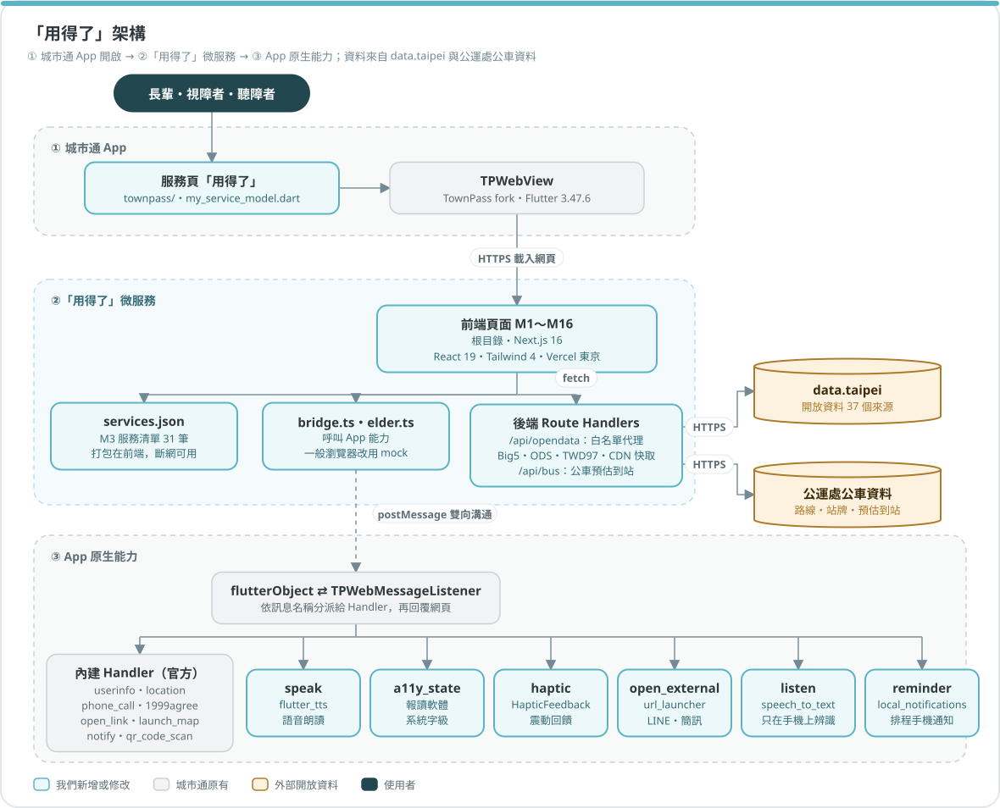
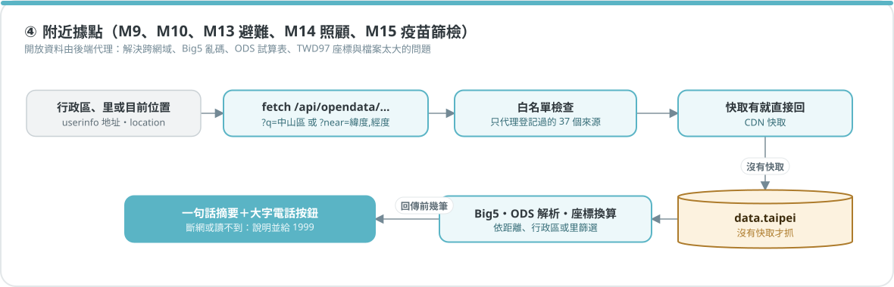
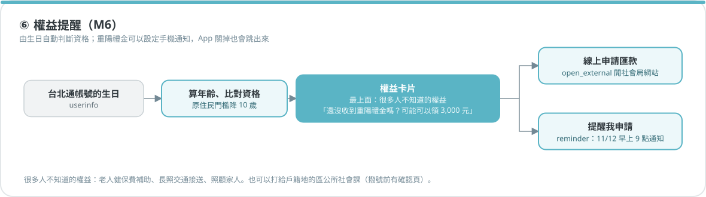
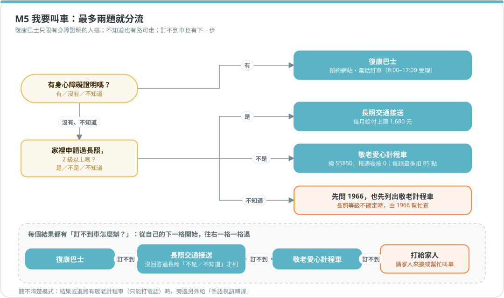

# 用得了

> 看不清楚、聽不清楚，都用得了。（開發代號：長輩模式。程式碼、規格文件裡的「長輩模式」都是指本服務）

> 2026 臺北秋季程式設計節 · 城市通微服務大黑客松　參賽作品（AI城市起風 × 奇鋒國際 PEAKQI）
> **說一句話，城市就聽懂。** 長輩、視障者、聽障者用同一個入口，依「需求」而不是「機關」找到市府服務；每條路都有不靠聲音、也不靠眼睛的替代方式。

- 微服務網頁：https://townpass2026-peakqi.vercel.app/
- 修改後的城市通 App：[Peakqi-com/TownPass](https://github.com/Peakqi-com/TownPass)（新增 Handler 與權限，不改既有流程）
- 功能規格（開發以此為準）：[TownPass `docs/townpass/elder-mode-spec.md`](https://github.com/Peakqi-com/TownPass/blob/main/docs/townpass/elder-mode-spec.md)

---

## 1. 要解決的問題

- **誰**：長輩，以及同樣是長輩居多的視障者、聽障者。全國聽障者 76.3%、視障者 59.4% 年滿 65 歲（衛福部 2026-06）；臺北市 65 歲以上人口占 23.9%（主計處統計週報第 1355 號）。
- **在什麼時候**：要看醫生、叫車、辦補助、找附近的共餐據點，或遇到緊急狀況時。
- **遇到什麼困難**：
  - 市府服務依「機關」分類，要先知道「這件事歸誰管」，入口又散在電話、臨櫃和各局處網站。
  - 長輩卡在流程：用過健保快易通的長輩，42.2% 是靠別人幫忙操作（數發部 111 年調查）；「不知道有這個服務」約占 17／100。
  - 很多服務只能打電話，聽障者用不了；地圖和小字對視障者讀不到。

研究與出處見 TownPass repo 的 `docs/townpass/`（`accessibility-research.md`、`taipei-elderly-services.md`、`taipei-disability-services.md`、`taipei-subsidies.md`）。

## 2. 設計原則

全國聽障者 76.3%、視障者 59.4% 年滿 65 歲，**他們大多就是長輩**。所以視障、聽障做成「模式」，不另外做服務，一個入口照顧三類人。

| # | 原則 | 為什麼 |
|---|---|---|
| 1 | **動作要熟**：按鈕的結果只有撥電話、開 LINE、開一頁大字說明 | 長輩上網者 95.1% 用即時通訊 |
| 2 | **選項要少**：首頁 4～6 個大按鈕，由家人挑選；其餘服務用說的或打字找 | W3C WAI-AGE |
| 3 | **每個回饋至少兩種感官**：唸出來＋大字＋震動；螢幕閱讀器開著時不自己唸 | 避免和 VoiceOver／TalkBack 重複播報 |
| 4 | **只能用聲音完成的路，旁邊都有一條文字路**，兩個按鈕一樣大 | 聽障者最大的困境是無法接聽電話 |
| 5 | **按錯不怕**：每頁只有一個「回首頁」；撥號前有確認頁；不自動逾時、不自動跳頁 | WCAG 2.2.1 |
| 6 | **主動告訴長輩「你有這個權益」**：用生日和行政區帶出符合資格的內容 | 「不知道有這個服務」約 17／100 |
| 7 | **家人是共同使用者**：設定和緊急聯絡有家人參與，但長輩自己操作 | 用健保快易通的長輩 42.2% 靠別人操作 |
| 8 | **只放官方電話和網址**，標出主責機關和查證日期；來源矛盾時明白寫出來 | 119 簡訊號碼有兩個官方版本 |
| 9 | **不在 Demo 送出真實求救**：119、110 只顯示範本，由使用者自己按送出 | — |

數字的出處見 `docs/` 的研究文件（`accessibility-research.md`、`taipei-elderly-services.md`、`taipei-disability-services.md`）。

## 3. 主要功能

| 模組 | 頁面 | 功能 | 狀態 |
|---|---|---|---|
| M0 | （App 端） | App 端橋接：朗讀、震動、無障礙狀態、開啟外部 App、裝置端語音辨識 | ✅ |
| M1 | `/`、`/mode` | 首頁與模式：6 個大按鈕、重陽禮金提醒、固定的 1999／1966／求助；「都還好／看不清楚／聽不清楚」三種模式，可調整唸的速度 | ✅ |
| M2 | `/find` | 找服務：打字、點選分類、說話（點一下開始、再點一下停止），用關鍵字比對（頁面打開後斷網也能用，見下方「斷網」） | ✅ |
| M3 | `src/data/services.json` | 服務清單：跨局處的開源 JSON（`phrases`、`alt_channels`、`audience`、`source`、`verified`），目前 30 筆 | ✅ |
| M4 | `/health` | 我要看醫生：聯醫掛號、叫車、1966 一次列出；聽不清楚模式加看診溝通卡、手語翻譯 | ✅ |
| M5 | `/ride` | 我要叫車：最多兩題，分流到復康巴士、長照交通接送、敬老計程車 | ✅ |
| M6 | `/benefits` | 我的權益：重陽禮金、敬老卡、公費疫苗、老人健檢，依生日與戶籍自動判斷；重陽禮金可以「提醒我申請」（排程手機通知） | ✅ |
| M7 | `/family`、`/family/setup` | 家人：家人用 QR code 幫長輩設定首頁按鈕與聯絡人（不經過伺服器）、打給家人 | ✅ |
| M8 | `/text`、`/help`、`/card/clinic` | 聽不清楚：文字聯絡管道、全螢幕求助卡、119 簡訊範本、看診溝通卡與手語翻譯申請文字 | ✅ |
| M9 | `/community` | 附近吃飯、上課：依行政區列出共餐、關懷據點、長青學苑、樂齡學習 | ✅ |
| M10 | `/vision` | 視障出門：用一句話說出最近捷運站的電梯位置、異常公告與附近有聲號誌 | ✅ |
| M11 | `/antifraud` | 防詐先問一下：點選或打出（也可以說）對方說了什麼，在手機裡比對 6 種常見詐騙說法，說「這很像〇〇詐騙」＋165 全民防騙網的官方提醒，再一鍵打給家人或 165；比對不到時只說「不確定，先停下來」，絕不說「安全」 | ✅ |
| M12 | `/benefits/subsidy` | 補助小幫手：三題篩出「可能可以申請」的補助，附應備文件、戶籍地社會課與家人代辦準備單；含假牙補助（先到聯醫做口腔檢查，由醫院送件） | ✅ |
| M13 | `/shelter` | 颱風、地震時去哪裡：用台北通帳號的「里」找出負責的避難收容處所，不用輸入地址；可選颱風淹水或地震，有無障礙設施、和家同一條路的排前面 | ✅ |
| M14 | `/care` | 照顧家人：失智症篩檢合約醫院、喘息服務特約單位（依服務範圍）、家庭照顧者服務中心、健康服務中心 | ✅ |
| M15 | `/health/places` | 打疫苗、做篩檢：依行政區列出公費流感、肺炎鏈球菌疫苗、五癌篩檢的合約院所，以及假牙補助院所 | ✅ |

各頁都已用瀏覽器在三種模式下檢查報讀（見下方「無障礙」）；⚠️ 尚未用實機開 VoiceOver／TalkBack 完整實測。

### 三種模式

模式只改變行為，服務內容都一樣。第一次使用會先選模式，之後隨時可以換（`src/components/elder/ModePicker.tsx`）。

| | 都還好 | 看不清楚 | 聽不清楚 |
|---|---|---|---|
| 按下按鈕 | 震動＋大字＋唸出名稱 | 同左 | 震動＋大字，**不出聲音** |
| 字級 | 跟手機設定 | **至少放大 1.3 倍** | 跟手機設定 |
| 唸的速度 | 可調，預設「慢」 | 可調，預設「正常」，可以調到最快 | 不顯示（不唸） |
| 找服務 | 說話或打字 | 說話或打字 | **只有打字** |
| 首頁的 1999 | 直接撥號 | 直接撥號 | **改成「1999 文字」** |
| 電話與文字管道 | 電話在前 | 電話在前 | **文字在前**；只能打電話的服務會明講，並給替代方式 |
| 其他 | — | 搜尋同分時，視障相關服務排前面 | 看診溝通卡、手語翻譯、119 簡訊排在撥號前；叫車結果加上手語視訊轉譯 |

螢幕閱讀器開著時，三種模式都不自己唸，交給 VoiceOver／TalkBack。

## 4. 系統架構



<details>
<summary>文字版</summary>

```
使用者：長輩・視障者・聽障者
① 城市通 App（TownPass fork・Flutter 3.47.6）
   服務頁「用得了」（my_service_model.dart，預設置頂）→ TPWebView（flutter_inappwebview）
        │ HTTPS 載入網頁
② 「用得了」微服務（本 repo・Next.js 16・React 19・Tailwind 4・Vercel 東京）
   前端頁面 M1～M12
   ├ services.json：M3 服務清單 30 筆（打包在前端，斷網可用）
   ├ bridge.ts・elder.ts：呼叫 App 能力；一般瀏覽器改用 mock
   └ 後端 /api/opendata：白名單代理、Big5 轉碼、ODS 解析、TWD97 換算、CDN 快取 ──HTTPS──► data.taipei（37 個來源）
        │ postMessage 雙向溝通
③ App 原生能力：flutterObject ⇄ TPWebMessageListener，依訊息名稱分派
   內建（官方）：userinfo・location・phone_call・1999agree・open_link・launch_map・notify・qr_code_scan
   新增：speak（flutter_tts）・a11y_state（報讀軟體、字級）・haptic（震動）
         open_external（url_launcher：LINE、簡訊）・listen（speech_to_text，只在手機上辨識）
         reminder（flutter_local_notifications：排程手機通知）
```

</details>

程式位置：
- 前端頁面：`src/app/**/page.tsx`（城市通色票＋本服務的按鈕色票，見下方「無障礙」）
- 呼叫 App：`src/lib/townpass/bridge.ts`（內建 Handler）、`src/lib/townpass/elder.ts`（新增 Handler）；一般瀏覽器會自動改用 mock
- 後端：`src/app/api/opendata/[source]/route.ts`（開放資料代理）

架構圖與下一節的流程圖，由 TownPass repo 的 `docs/townpass/diagrams/build_diagrams.py` 產生（色票取自城市通 UI Kit）；本 repo 的 `docs/diagrams/` 是複本。要改圖時改那支程式，重跑後再把 SVG 複製過來。

### 新增的 App Handler

App 端程式在 TownPass 的 `lib/util/web_message_handler/elder_mode_message_handlers.dart`；網頁端呼叫方式在 `src/lib/townpass/elder.ts`。

| name | 網頁送出 | App 回覆 | 說明 |
|---|---|---|---|
| `speak` | `'叫車'` 或 `{ text, rate? }` | `true`／`false` | 系統 TTS（flutter_tts），語速預設 0.45、限制 0.2～1.0，文字上限 200 字。螢幕閱讀器開著時網頁不呼叫 |
| `a11y_state` | `null` | `{ screenReader, textScale }` | 螢幕閱讀器開著時網頁不自己唸；`textScale` 用來設定根字級（城市通 WebView 不跟隨系統字級） |
| `haptic` | `'light'`／`'medium'` | `true` | 觸覺回饋（iOS WebView 不支援 `navigator.vibrate`） |
| `open_external` | 網址字串 | `true`／`false` | 用外部 App 開啟（LINE、簡訊、撥號畫面）。只允許 https、tel、sms、mailto |
| `listen` | `{ action: 'start'｜'stop'｜'cancel', locale? }` | 先回 `{ status: 'listening' }`，再回 `{ text }` 或 `{ error }` | 裝置端語音辨識。**只開放本服務網域**；手機不支援離線辨識時回 `offline_unavailable`，**不會改用雲端** |
| `reminder` | `{ action: 'set', id, title, body, at }`／`{ action: 'cancel', id }` | `{ status: 'scheduled', at }`／`{ status: 'cancelled' }`／`{ error }` | 排程手機通知，App 關掉也會跳（flutter_local_notifications）。**只開放本服務網域**；`at` 要帶時區，限 1 分鐘後到 400 天內 |

### 開放資料代理

data.taipei 多數資料沒有開放 CORS，且部分為 Big5 編碼、TWD97 座標，因此由後端代理：

```
GET /api/opendata                                    列出可用來源
GET /api/opendata/<id>?near=緯度,經度&radius=500&limit=20&q=關鍵字
```

- 只代理 `src/lib/opendata/sources.ts` 登記的來源（白名單），不接受任意網址
- 統一轉成 JSON（含 .ods 試算表，用 Node 內建 zlib 解壓，不需要套件），TWD97 座標換算為 WGS84，可依位置篩選附近的點（附 `distance` 公尺），或用 `q` 依行政區等文字篩選
- 依來源更新頻率設定 CDN 快取（`s-maxage`），上游暫時失敗時回傳最近一次的資料（`stale: true`）

### 無障礙與報讀軟體

- 不綁定特定報讀軟體，只用標準的無障礙語意，VoiceOver、TalkBack 與第三方報讀軟體都讀得到。
- 每頁一個 h1，換頁後焦點移到標題；按鈕都有可見文字；圖示一律 `aria-hidden`；DOM 順序＝視覺順序。
- 操作結果寫進同一個 live region（`role="status"`），不從 App 端呼叫原生通知（Android 已棄用 `announceForAccessibility`），避免唸兩次。
- 操作失敗時（打不開簡訊、不能撥號、拿不到位置），失敗訊息除了大字提示，也會留在按鈕下方，直到下一次操作才清掉，不會幾秒後就消失。聽不清楚模式沒有聲音，畫面上的字是唯一的提示（`src/components/elder/FailNote.tsx`，WCAG 2.2.1）。
- 按鈕配色照顧辨色能力退化的長輩：紅色只給「求助」，顏色固定跟著服務類別；按下時用粗框表示，不靠變色。用 8 種視覺條件（正常、紅色盲、綠色盲、藍黃色盲，各自再加上水晶體老化）模擬，任兩色的最小色差從提案原配色的 ΔE00 3.1 提高到 10.1。色票與計算方式見 `docs/elder-mode-spec.md` §4.1、`docs/elder-palette/check_palette.py`。
- 打開服務時會在首頁前墊一筆「選模式」的瀏覽紀錄，城市通 AppBar 的返回鍵因此一定會出現，可以回去換模式（`src/lib/elder/entry.ts`）。
- 檢查腳本：`scripts/a11y-check.js`，貼到 Chrome DevTools 的 Console 執行（App 內的 WebView 可用 `chrome://inspect` 連上）。原生機制與網頁做法的對照見 `CLAUDE.md` §4.5。

### 斷網

評審可能關掉網路測試。目前的做法與限制（`src/components/elder/OfflineSupport.tsx`）：

- 一打開服務、有網路時，就預載全部 40 個頁面（`src/lib/elder/routes.ts`），預載內容保留 1 天（`next.config.ts` 的 `staleTimes`）。
- 開啟 Next.js 的 `experimental.useOffline`：斷網時點到沒預載的頁面，不會跳到瀏覽器錯誤頁，網路恢復後自動重試。
- 斷網時頁首顯示「現在沒有網路。附近的據點和捷運資料暫時查不到，其他功能照常可以用」。
- 斷網後能用：首頁、找服務（打字比對）、看醫生、叫車、我的權益、補助小幫手、家人、文字聯絡、求助卡、看診溝通卡、撥號確認頁。撥號、震動、朗讀由 App 處理，不需要網路。
- 斷網後不能用：附近共餐上課、視障出門的即時資料（畫面會說「暫時讀不到」並給替代方式）。
- ⚠️ **斷網後「重新打開」服務會打不開。** 要做到需要 Service Worker，而 iOS 的 WebView 只有在 App 宣告 App-Bound Domains 時才支援，會影響城市通裡其他服務，所以不採用。**Demo 時一定要先在有網路時打開服務，再開飛航模式。**

## 5. 主要流程

**① 開啟「用得了」**



<details>
<summary>文字版</summary>

```
台北通「我的服務」→ 點「用得了」→ WebView 載入 Vercel 網址
→ bridge：userinfo（姓名、生日、行政區）、a11y_state（報讀軟體、字級）
→ 讀手機裡的設定（模式、語速、家人設定的按鈕）
→ 算年齡 → 篩出首頁按鈕和權益卡片 → 畫面
第一次使用會先到「選模式」頁；打開時在首頁前墊一筆「選模式」紀錄（返回鍵可以回去換模式），並預載全部頁面
```

</details>

**② 按一顆大按鈕**



<details>
<summary>文字版</summary>

```
點按 → 震動（haptic）
     → 報讀軟體沒開：speak 唸出名稱＋大字（role="status"）；開著：只顯示大字，報讀軟體自己會唸
     → 需要確認的動作先顯示確認頁（例如撥號）
     → 依 action 執行：phone_call／1999agree／open_link／open_external／切換頁面
     → 失敗 → 改用 fallback；聽不清楚模式先給文字管道；失敗訊息留在按鈕下方，不會 4 秒就消失
```

</details>

**③ 找服務（M2）**



<details>
<summary>文字版</summary>

```
打字 ──────────────────────────────┐
點一下開始說話、再點一下停止 → listen（在手機上辨識）→ 文字 ┤
              （不支援離線辨識 → 提示改用打字）            ▼
        正規化 → 比對 services.json 的 phrases → 最多三筆
        → 「你是說：…？」＋三個大按鈕
        → 都對不上 → 「要不要打 1999 問問看」
點分類 → 該分類的服務清單
```

</details>

**④ 附近據點（M9、M10）**



<details>
<summary>文字版</summary>

```
userinfo.addresses[].town 或 location
→ fetch /api/opendata/{source}?q=中山區（或 near=緯度,經度）
→ Route Handler：白名單 → 快取命中就直接回 → 否則抓 data.taipei → Big5 轉碼、座標轉換
→ 回傳前幾筆 → 一句話摘要＋大字電話按鈕（斷網或讀不到：說明並給 1999）
```

</details>

**⑤ 家人代設定（M7）**



<details>
<summary>文字版</summary>

```
家人手機：「用得了」→「我是家人」→ 勾首頁按鈕、填電話與行政區 → 產生 QR（設定內容在 QR 裡）
長輩手機：「家人幫我設定」→ qr_code_scan → 檢查格式、版本、隱藏字元 → 存在手機裡 → 唸「設定好了」
（全程不經過伺服器）
```

</details>

**⑥ 權益提醒（M6）**



<details>
<summary>文字版</summary>

```
userinfo.birthday → 年齡（原住民門檻降 10 歲）→ 比對資格
→ 權益卡片「可能可以領 3,000 元，還有 6 天截止」
→ 「線上申請匯款」→ open_external 開社會局網站
→ 「提醒我申請」→ reminder（11/12 早上 9 點跳出手機通知，App 關掉也會跳）
```

</details>

### 決策流程

**M5 我要叫車：最多兩題分流**



<details>
<summary>文字版</summary>

```
有身心障礙證明嗎？
├ 有 → 復康巴士：預約網站・電話訂車（8:00–17:00 受理）
└ 沒有、不知道 → 家裡申請過長照，2 級以上嗎？
    ├ 是 → 長照交通接送（每月給付上限 1,680 元）
    ├ 不是 → 敬老愛心計程車：撥 55850，接通後按 0；每趟最多扣 85 點
    └ 不知道 → 先問 1966，也先列出敬老計程車
聽不清楚模式：結果是只能打電話的服務時，另外給「手語視訊轉譯」
```

</details>

復康巴士只限持身障證明的人搭乘，很多長輩以為能叫，所以提案原本的「叫復康巴士」按鈕改成「我要叫車」，先分流。

**M12 補助小幫手：自動帶入＋三題**



<details>
<summary>文字版</summary>

```
自動帶入（不用問）：年齡、原住民身分（門檻降 10 歲）、行政區 ← 台北通帳號
→ 三題大按鈕，都有「不知道」：
   1. 有身心障礙證明嗎？（有 → 看不清楚／聽不清楚／其他）
   2. 家裡收入：有低收或中低收證明／沒有，但收入不高／不知道
   3. 家裡有人需要別人照顧嗎？
→ 結果分三塊：您可能可以申請／不用申請，會自動入帳或減免／答「不知道」的提示
→ 每張卡片：一句話＋大約金額、要準備什麼、戶籍地社會課、家人能不能代辦、申請準備單
```

</details>

只說「可能可以申請」，不說「符合」，最後由社會局審核；答案只存在手機裡，不上傳。

## 6. 設計取捨

開發前的規劃書有幾處和研究、實測結果衝突，以研究結果為準改掉：

| 原本的想法 | 問題 | 改成 |
|---|---|---|
| 語音辨識用 whisper.cpp（WebAssembly） | Android WebView 不支援 `SharedArrayBuffer`，多執行緒 WASM 跑不了；模型 57 MB、執行時約需 388 MB 記憶體 | App 端 `listen` Handler，用手機系統的裝置端辨識 |
| 朗讀用瀏覽器的 `speechSynthesis` | Android WebView 不支援 | App 端 `speak` Handler（flutter_tts） |
| 字級「跟隨系統放大」 | 城市通的 WebView 把字級固定在 100%，iOS 也不跟隨系統 | `a11y_state.textScale` 加上全站 `rem` |
| 按住說話、放開送出 | VoiceOver 使用者很難按住不放 | 點一下開始、再點一下結束，並一定有打字 |
| 每顆按鈕都能「退回撥電話」 | 聽障者打不了電話 | `fallback` 之外，再加 `alt_channels` 文字管道 |
| 首頁放「叫復康巴士」 | 復康巴士只限持身障證明者 | 「我要叫車」加分流（M5） |
| 地圖用 flutter_map | 微服務是網頁 | 用一句話說出位置，必要時再用 Leaflet＋OpenStreetMap |
| 每日報平安（沒按就通知家人） | 需要伺服器或簡訊，也有通報責任問題 | 列為下一階段 |

**不採用的技術**：網頁的 Web Speech API 辨識（Chrome 預設送到雲端辨識，違反執行時不呼叫雲端的規則）、sherpa-onnx（由小米的 k2-fsa 團隊開發，和「不使用大陸廠牌」的原則不符）、Service Worker 離線快取（見上方「斷網」）。

## 7. 執行方式

需求：Node.js 24 以上。

```bash
npm ci
cp .env.example .env.local   # 目前用到的資料來源都不需要金鑰
npm run dev                  # http://localhost:3000（一般瀏覽器會自動使用 mock 資料）
npm test                     # 單元測試（node --test）
npm run lint
npx tsc --noEmit
npm run build
```

在城市通 App 內測試：

1. 部署到 HTTPS 網址（App 的 WebView 無法開啟 http），或用 ngrok 對外提供本機服務
2. 新網域要加進 TownPass 的 `lib/util/elder_mode_config.dart` 的 `trustedHosts`，否則 `listen` 會回 `forbidden`
3. TownPass 已在 `my_service_model.dart` 登記本服務並預設置頂；`fvm flutter run` 後到「服務」頁開啟
4. 開發用測試頁在 `/dev`，可以逐一測試新增的 Handler。語音辨識請開飛航模式再測一次

### 評審試用路徑（約 2 分鐘）

測試帳號在 TownPass 的 `assets/mock_data/account.json`（生日 1940/03/01，86 歲，示範重陽禮金 3,000 元級距）。

1. 台北通 →「服務」→「用得了」。首頁顯示「午安，陳阿嬤」和「重陽禮金 3,000 元，還有 6 天截止」。
2. 按「說話或打字找服務」，輸入「我要去看醫生」→ 出現聯醫掛號、叫車、1966 三個大按鈕，跨三個機關。
3. 按「叫車」→「有身障證明嗎？沒有」→ 敬老計程車，並說明復康巴士只限身障者。
4. 回首頁按「換模式」，改成「我聽不清楚」：同一個首頁，1999 變成「1999 文字」，撥號旁都有「用文字」；按底部的「求助」，可以看到全螢幕求助卡和 119 簡訊範本（不會自動送出）。
5. 「家人」→ 用另一支手機在「我是家人」產生 QR code，長輩的手機一掃，首頁按鈕就換好。
6. 開飛航模式：打字找服務、各頁切換、撥號確認都還能用。⚠️ **要先在有網路時打開服務，再開飛航模式**（見「斷網」）。

### 部署

**Vercel**（目前使用）：匯入本 repo 即可。Function 區域設定在 `vercel.json`（`hnd1` 東京）。

**容器（Cloud Run 或其他）**：本 repo 附 `Dockerfile`（Next.js standalone 輸出），可以不依賴 Vercel 自行部署：

```bash
gcloud run deploy townpass2026-peakqi --source . --region asia-east1
# 或在本機執行
docker build -t townpass2026-peakqi . && docker run -p 8080:8080 --env-file .env.local townpass2026-peakqi
```

### 環境變數

| 名稱 | 用途 | 取得方式 |
|---|---|---|
| `TDX_CLIENT_ID`／`TDX_CLIENT_SECRET` | 目前沒有用到；之後若接 TDX 交通資料才需要 | [TDX](https://tdx.transportdata.tw/) 免費註冊 |

金鑰只放在 `.env.local`，不可 commit。

## 8. 資料來源

授權：政府資料開放授權條款第 1 版。代理目前登記的全部來源可用 `GET /api/opendata` 查詢；下表列出本服務使用（或規劃使用）的資料集。

| 資料集 | 提供機關 | 連結 | 用途 | 狀態 |
|---|---|---|---|---|
| 公私立醫院 | 衛生局 | [b02cd6b2…](https://data.taipei/dataset/detail?id=b02cd6b2-79be-4d7f-ae78-305b2af668f5) | M4 我要看醫生 | 規劃中 |
| 老人共餐單位一覽表 | 社會局 | [fe55795c…](https://data.taipei/dataset/detail?id=fe55795c-a220-4b88-bde1-5b994321f8af) | M9 附近共餐 | 使用中 |
| 社區照顧關懷據點 | 社會局 | [d082dc87…](https://data.taipei/dataset/detail?id=d082dc87-d3fd-479d-89c6-745ff1be955a) | M9 | 使用中 |
| 長青學苑 | 社會局 | [67b63404…](https://data.taipei/dataset/detail?id=67b63404-89b8-4214-8096-3322204144e6) | M9 | 使用中 |
| 樂齡學習據點 | 教育局 | [ca59e66b…](https://data.taipei/dataset/detail?id=ca59e66b-7200-4283-8c32-08bde2f5f142) | M9（樂齡學堂＋樂齡學習中心） | 使用中 |
| 流感疫苗合約醫療院所（成人） | 衛生局 | [0db13d34…](https://data.taipei/dataset/detail?id=0db13d34-51e3-497a-a023-286d5ef692ea) | M6 疫苗 | 規劃中 |
| 臺北捷運車站無障礙設施資料 | 捷運公司 | [3c799405…](https://data.taipei/dataset/detail?id=3c799405-4e44-40dd-b747-daed09e88cdb) | M10 視障出門 | 使用中 |
| 臺北捷運車站出入口無障礙電梯、坡道座標 | 捷運公司 | [0a3bb422…](https://data.taipei/dataset/detail?id=0a3bb422-9eb5-459b-a9d4-138456516183) | M10 | 使用中 |
| 交工處無障礙設施設置資料（有聲號誌） | 交通局 | [baf32b58…](https://data.taipei/dataset/detail?id=baf32b58-b194-448d-96a0-ba04013d164f) | M10 | 使用中 |
| 臺北捷運車站無障礙設施異常公告 | 捷運公司 | [d884a9c6…](https://data.taipei/dataset/detail?id=d884a9c6-f86c-4854-8da7-e6516ddbe612) | M10 | 使用中 |
| 臺北市老人服務中心 | 社會局 | [78dfc9a2…](https://data.taipei/dataset/detail?id=78dfc9a2-36e2-4ef5-beaa-a74633ba3d26) | M9（預留） | 代理已登記 |
| 臺北市可供避難收容處所一覽表 | 教育局 | [aaf97773…](https://data.taipei/dataset/detail?id=aaf97773-3631-40e2-b3cc-da87bf2ce1d5) | M13 避難所（.ods，419 處；不傳個人姓名與電話） | 使用中 |
| 臺北市失智症篩檢、確診評估及關懷服務計畫合約醫院 | 衛生局 | [1417e9ae…](https://data.taipei/dataset/detail?id=1417e9ae-4c86-4f74-88a2-d7031712db44) | M14 失智篩檢（全市 11 家） | 使用中 |
| 臺北市長照喘息服務特約單位 | 衛生局 | [959c34b2…](https://data.taipei/dataset/detail?id=959c34b2-9698-4d99-8987-d389efe18c04) | M14 喘息服務（巷弄式、社區式、居家式） | 使用中 |
| 臺北市銀髮族服務_家庭照顧者服務中心 | 社會局 | [e3cec007…](https://data.taipei/dataset/detail?id=e3cec007-4212-4944-989e-5078e4f5f3bb) | M14 照顧者支持 | 使用中 |
| 臺北市健康服務中心 | 衛生局 | [d4c6d4e0…](https://data.taipei/dataset/detail?id=d4c6d4e0-c2b4-48e3-99b4-f670d820326b) | M14、M15 | 使用中 |
| 臺北市流感疫苗合約醫療院所(成人) | 衛生局 | [0db13d34…](https://data.taipei/dataset/detail?id=0db13d34-51e3-497a-a023-286d5ef692ea) | M15 流感疫苗 | 使用中 |
| 臺北市公費肺炎鏈球菌疫苗合約醫療院所名單 | 衛生局 | [92934ab2…](https://data.taipei/dataset/detail?id=92934ab2-3509-4a6b-9cee-9ac556ca2f65) | M15 肺炎鏈球菌疫苗 | 使用中 |
| 臺北市五癌篩檢醫療院所 | 衛生局 | [ae20d75c…](https://data.taipei/dataset/detail?id=ae20d75c-dffb-4d4f-85e1-9c512189005c) | M15 癌症篩檢 | 使用中 |
| 臺北市假牙補助醫療院所名單 | 社會局 | [76b8b514…](https://data.taipei/dataset/detail?id=76b8b514-e793-4cca-8dcf-065d5af4b760) | M15、M12 假牙補助 | 使用中 |

服務清單（M3）裡的電話、網址、補助資格與金額，是隊員從市府官網整理後寫入的，每筆都附 `source` 與 `verified`（查證日期）。

聽障者求助相關（M8）：
- 119 簡訊範本照[臺北市政府消防局宣導單](https://www-ws.gov.taipei/001/Upload/691/relfile/61747/8937655/b275fc3e-70f8-4e5b-83da-f7fdb9a77e18.pdf)的官方格式。
- 119／110 簡訊報案號碼：消防署開放資料 [data.gov.tw/dataset/7917](https://data.gov.tw/dataset/7917)、警政署 [data.gov.tw/dataset/7916](https://data.gov.tw/dataset/7916)。**119 簡訊號碼在官方來源中有兩個版本，畫面上兩個都列並標示待確認。**
- 求助卡、看診溝通卡的文字是隊員預先寫好的固定內容，不是 AI 產生。

防詐先問一下（M11）：
- 詐騙手法、關鍵字與提醒文字取自[內政部警政署 165 全民防騙網](https://165.npa.gov.tw/)的官方文章（假檢警、解除分期付款、假中獎、假投資、猜猜我是誰、騙帳號密碼），每筆在 `src/data/antifraud.json` 附原文網址與查證日期；查證紀錄見 `docs/antifraud-research.md`。比對規則是隊員預先寫好的關鍵字，不是 AI 產生。
- 165 LINE 官方帳號 `@tw165`：165 打詐儀錶板（刑事警察局）首頁的連結；官方說明的功能是查網址有沒有被通報。

> 核心資料使用合法開放資料；如有模擬資料會在此標示。

## 9. 第三方套件

**本 repo（微服務網頁）**

| 套件 | 授權 |
|---|---|
| next | MIT |
| react、react-dom | MIT |
| tailwindcss、@tailwindcss/turbopack | MIT |
| typescript | Apache-2.0 |
| eslint、eslint-config-next | MIT |
| qrcode 1.5.4（M7 家人代設定產生 QR code） | MIT |
| @types/qrcode | MIT |

**TownPass fork 新增的 Flutter 套件**

| 套件 | 授權 | 用途 |
|---|---|---|
| flutter_tts 4.2.5 | MIT | `speak` |
| speech_to_text 7.5.0 | BSD-3-Clause | `listen` |
| timezone 0.11.1 | BSD-2-Clause | `reminder`（原本就是 flutter_local_notifications 的間接依賴，改為直接引用） |

## 10. AI 使用聲明

- **開發階段**：使用 Claude Code 協助研究資料、撰寫程式與測試、起草文件；程式碼與資料來源皆經隊員閱讀確認。
- **執行階段**：**不使用任何大型語言模型**，也不呼叫任何雲端 AI API。服務比對使用關鍵字規則。語音辨識使用手機作業系統內建的**裝置端**辨識引擎：

| 項目 | 內容 |
|---|---|
| 模型名稱 | 不自備模型；使用作業系統內建的語音辨識（Android `SpeechRecognizer` 裝置端辨識器、iOS `SFSpeechRecognizer`） |
| 版本 | 依手機作業系統版本 |
| 量化格式 | 不適用 |
| 推論框架 | speech_to_text 7.5.0（BSD-3-Clause），設定 `onDevice: true` |
| 來源 | 手機作業系統 |

> 依競賽規範，執行時的推論都在裝置端完成：iOS 設定 `requiresOnDeviceRecognition`；Android 先確認 `SpeechRecognizer.isOnDeviceRecognitionAvailable`，不支援就停用語音、改用打字，不會改用雲端辨識。

## 11. 評估面向對照

| 面向 | 本作品的做法 |
|---|---|
| 安全（個資保護、防攻擊、能被監督） | 語音只在手機裡辨識；補助篩選的答案只存在手機；家人設定用 QR code 直接傳遞，不經過伺服器。麥克風只開放本服務網域；`open_external` 只允許 4 種 scheme；開放資料代理採白名單 |
| 創新（新想法、能持續改） | 一個入口照顧三類人（模式只改變行為、不改內容）；服務清單是開源 JSON，局處可以自行補「長輩的說法」 |
| 有感（解決需求、可擴充） | 依需求而不是機關找服務；一按就撥號或開官方頁面；主動告訴長輩「你有這個權益」 |
| 參與（方便表達意見、參與社區） | 附近共餐、關懷據點、長青學苑；家人與里辦志工可以協助設定 |
| 便利（數位歸戶、無縫接軌、主動推薦） | 用 `userinfo` 的生日與行政區自動判斷資格、帶出同區據點 |
| 透明（用語淺白、即時更新、指引清楚） | 每筆服務標示主責機關、官方連結與查證日期；補助只說「可能可以申請」，最後由社會局審核 |

## 12. 維運說明

- **資料由誰更新**：開放資料由各局處在 data.taipei 更新，代理即時抓取。服務清單（電話、網址、補助資格）是一份 JSON，規劃由各局處自行維護；每筆都有查證日期，方便定期檢查。
- **問題由誰處理**：得獎後協助資訊局整併；程式架構與測試說明見本 README 與 TownPass `docs/townpass/`。

### 已知限制與待確認

| 項目 | 目前的處理 |
|---|---|
| 119 簡訊號碼在官方來源中有兩個版本 | 畫面上兩個都列並標示待確認；正式上線前要向臺北市消防局確認 |
| 尚未用實機開 VoiceOver／TalkBack 完整實測 | 已用瀏覽器在三種模式下檢查報讀；決選前要實機測 |
| 斷網後重新打開服務會打不開 | iOS WebView 的 Service Worker 限制，見「斷網」 |
| 敬老卡餘額、看診進度、訂車狀態沒有開放 API | 第一版引導打 1999；需要市府介接 |
| 〈失智症篩檢合約醫院〉資料集左右兩份清單並排、同一列沒有對應 | 只當全市 11 家醫院的清單用，不說「負責您這一區」；行政區用醫院地址判斷 |
| 避難收容處所實際開設哪幾處，要看災害當時市府的公告 | 畫面寫明「請以市政府當時的公告為準」 |
| 假牙補助能不能由家人代辦，官方沒寫；1999 分機在不同官方頁面互相矛盾 | 代辦寫「請先打電話問」；分機用社會局洽辦資訊頁的 1576（`taipei-subsidies.md` A.12） |
| 手語翻譯的承辦單位委託到 2026-12-31 | 服務清單的 `verified` 日期會顯示在畫面上，到期要重新查證 |
| 系統的裝置端語音辨識是否算「裝置端模型推論」 | 已依規則確保不送雲端（見「AI 使用聲明」）；如主辦認定不符，關掉語音、保留打字和點選即可 |

## 授權

本專案採 [GNU AGPL-3.0](LICENSE) 授權。修改後的城市通 App（[Peakqi-com/TownPass](https://github.com/Peakqi-com/TownPass)）沿用原專案的 GPL-3.0。

<!-- 待補：主辦單位在競賽須知（115.08.27 版）指定的授權聲明全文。指引只寫「附上主辦指定的授權聲明」，沒有附原文；向主辦取得後貼在這裡，不要自行改寫。 -->
