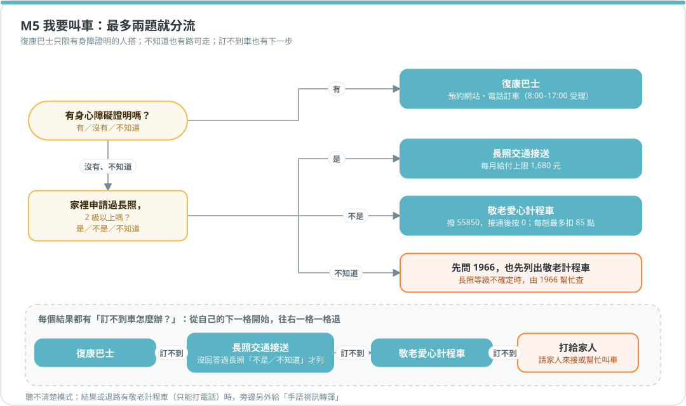
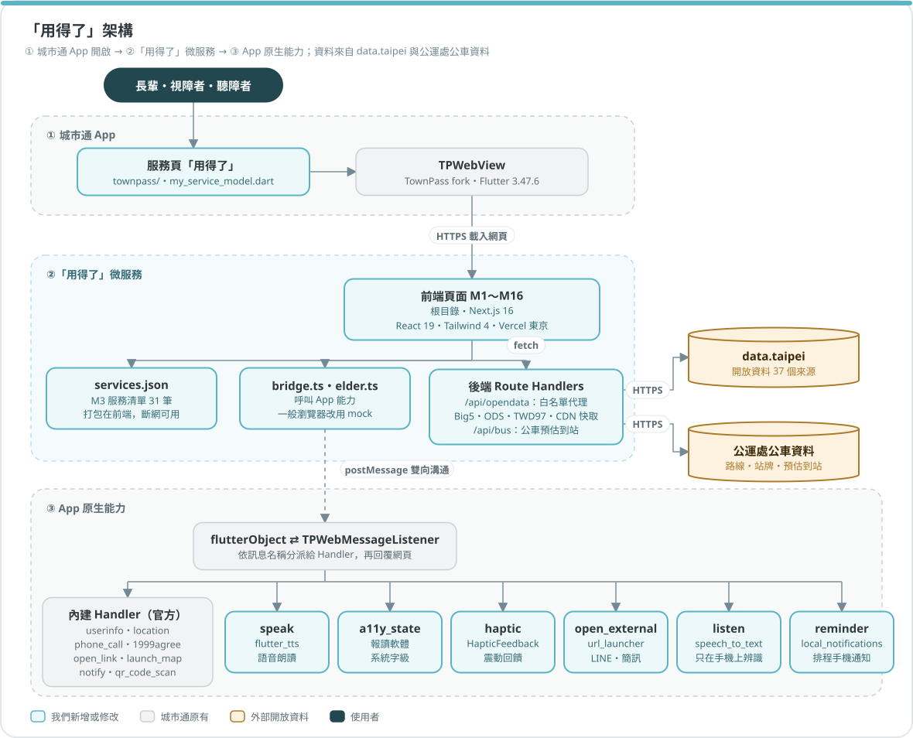
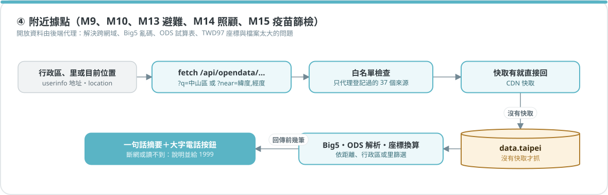
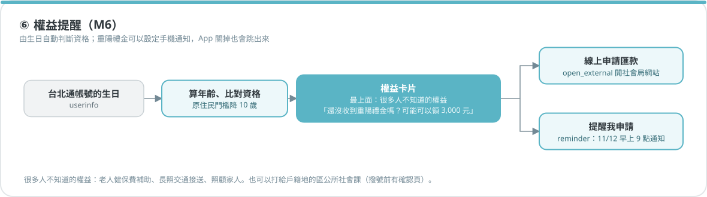

# 「用得了」功能規格（合併版）

> 服務名稱：**用得了**（2026-11-07 定名，回應子題「用不了 #身體限制」）。開發代號是「長輩模式」：程式碼、Handler、色票、檔名（`elder-mode-*`）都沿用代號，指的是同一個服務。

> 2026-11-07 整理。這份文件是**開發時唯一要看的規格**，合併了四份文件：
>
> | 來源 | 貢獻 |
> |---|---|
> | 《台北通長輩模式：服務研究與微服務規劃》（PeakQi，PDF，未進版控） | **骨架**：服務地圖、服務清單規格、介面規範、家人代設定、風險 |
> | [`accessibility-research.md`](accessibility-research.md) | WebView 技術限制、介面與互動層證據 |
> | [`taipei-elderly-services.md`](taipei-elderly-services.md) | 長輩數位習慣、市府長者服務（市府原頁查證）、資料集 |
> | [`taipei-disability-services.md`](taipei-disability-services.md) | 視障與聽障的管道、溝通需求、資料集 |
> | [`taipei-subsidies.md`](taipei-subsidies.md) | 補助的資格、金額、應備文件、申請管道、代辦（市府原頁查證） |
>
> 規劃書和研究結果衝突時，以研究結果為準，修正對照見 §9。每個事實的出處都在三份研究文件裡，這份不重複列；標 ⚠️ 的是還沒查證、或需要實機確認的項目。

---

## 0. 一句話定位

**一個掛在台北通「我的服務」裡的 WebView 微服務：長輩、視障者、聽障者用同一個入口，依「需求」而不是「機關」找到市府服務，而且每條路都有不靠聲音和不靠眼睛的替代方式。**

為什麼三類人可以共用一個入口：全國聽障者 76.3%、視障者 59.4% 年滿 65 歲（衛福部 2026-06）；臺北市眼、耳類身障者 73.2% 年滿 65 歲。**他們大多就是長輩**，所以視障、聽障做成「模式」，不另做服務。

## 1. 設計原則（合併版）

| # | 原則 | 來源 |
|---|---|---|
| 1 | **動作要熟**：按鈕的結果只有三種：撥電話、開 LINE、開一頁大字說明 | 規劃書；長輩上網者 95.1% 用即時通訊 |
| 2 | **選項要少**：首頁 4～6 個大按鈕，由家人挑選；其餘服務靠「說」或「打字」找 | 規劃書；W3C WAI-AGE |
| 3 | **每個回饋至少兩種感官**：唸出來＋大字＋震動。**螢幕閱讀器開啟時不要自己唸** | 研究 §4.1；避免和 VoiceOver 重複播報 |
| 4 | **每條只能用聲音完成的路，旁邊都有一條文字路**，兩個按鈕一樣大、並排 | 視障聽障研究 S2；聽障者的主要困境是無法接聽電話 |
| 5 | **按錯不怕**：每頁只有一個「回首頁」；撥號前有確認頁；不自動逾時、不自動跳頁 | 規劃書；WCAG 2.2.1 |
| 6 | **主動告訴長輩「你有這個權益」**：用生日和行政區自動帶出符合資格的內容 | 長輩研究 P4；「不知道有這個服務」約 17／100 |
| 7 | **家人是共同使用者**：設定和緊急聯絡預設有家人參與，但長輩自己操作 | 用健保快易通的長輩 42.2% 靠別人操作 |
| 8 | **只放官方電話和網址**，標出主責機關和查證日期；來源矛盾時明白寫出來 | 長輩研究 P7；119 簡訊號碼有兩個官方版本 |
| 9 | **不在 Demo 送出真實求救**：119、110 只顯示範本，不實際撥打或傳送 | 視障聽障研究 B.1-2 |

---

## 2. 功能模組總覽

| 模組 | 名稱 | 對象 | 狀態 |
|---|---|---|---|
| **M0** | App 端橋接（新增 Handler 與權限） | 全部 | ✅ 5 個 Handler：朗讀、無障礙狀態、震動、開啟外部 App、裝置端語音辨識 |
| **M1** | 首頁與模式 | 全部 | ✅ |
| **M2** | 找服務（打字、點選、說話） | 全部 | ✅ 打字、點選；說話要看手機是否支援 zh-TW 離線辨識，實機確認中 |
| **M3** | 服務清單（跨局處規格） | 全部 | ✅ 26 筆，每筆附來源與查證日期 |
| **M4** | 我要看醫生 | 長輩、聽障 | ✅ |
| **M5** | 我要叫車 | 長輩、身障者 | ✅ |
| **M6** | 我的權益（敬老卡、重陽禮金、疫苗、健檢） | 長輩 | ✅ 依生日判斷資格、說明、截止日倒數、線上申請禮金匯款、「提醒我申請」（`reminder` Handler 排程手機通知）。敬老卡餘額要市府介接，目前引導打 1999 |
| **M7** | 家人（代設定、打給家人） | 長輩 | ✅ |
| **M8** | 聽不清楚（文字替代、求助卡、溝通卡、手語翻譯） | 聽障 | ✅ App 已開放簡訊連結（Android `<queries>`、iOS `LSApplicationQueriesSchemes`）；簡訊能否帶入內文要實機確認 |
| **M9** | 附近共餐、上課 | 長輩 | ✅ |
| **M10** | 視障出門（捷運無障礙、有聲號誌） | 視障、聽障 | ✅ 新增 7 個開放資料來源 |
| **M11** | 防詐先問一下 | 長輩 | ✅ `/antifraud`：點選或打字（可說話）說出對方講了什麼，比對 165 官方整理的 6 種手法，給官方提醒與下一步（掛電話、問家人、問 165）。永遠不說「安全」；聽不清楚模式有 165 LINE 查網址 |
| **M12** | 補助小幫手 | 長輩、視障、聽障 | ✅ 篩選、應備文件、戶籍地社會課、家人代辦準備單。可線上申請的只有輔具補助與重陽禮金匯款，其餘依官方管道到區公所或打 1966 |
| **後端** | 開放資料代理 | — | ✅ 已上線，28 個來源 |

---

## 3. 各模組規格

### M0 App 端橋接

城市通 App（TownPass fork）**不改既有流程，只新增 Handler 和權限宣告**。指引第 03 章明寫可以「以自訂 Handler 擴充：音訊、裝置端 AI…」，擴充流程第 3 步就是加權限。

| Handler `name` | 網頁送出 | App 回覆 | 做法 | 狀態 |
|---|---|---|---|---|
| `speak` | `{ text, rate? }` | `true／false` | flutter_tts 呼叫系統 TTS，挑 `zh-TW` 且不需網路的聲音 | ✅ |
| `a11y_state` | `null` | `{ screenReader, textScale }` | `PlatformDispatcher` 的 `accessibleNavigation`、`textScaleFactor`。網頁用 `textScale` 設定根字級（雙平台一致，見下方說明） | ✅ |
| `haptic` | `'light'｜'medium'` | `true` | Flutter 內建 `HapticFeedback`，不需新套件 | ✅ |
| `open_external` | `url` | `true／false` | `launchUrl(uri, mode: LaunchMode.externalApplication)`，給 LINE、簡訊、VRS | ✅ |
| `listen` | `{ action: 'start'｜'stop'｜'cancel', locale? }` | 先回 `{ status: 'listening' }`，再回 `{ text }` 或 `{ error }` | speech_to_text，`onDevice: true`。**只開放本服務網域**。Android 先用 `MainActivity` 的原生方法確認 `SpeechRecognizer.isOnDeviceRecognitionAvailable`（API 31+），不可用就回 `offline_unavailable`，因為套件在不支援時會默默改用雲端辨識；iOS 由套件設定 `requiresOnDeviceRecognition` | ✅ |
| `reminder` | `{ action: 'set', id, title, body, at }`／`{ action: 'cancel', id }` | `{ status: 'scheduled', at }`／`{ status: 'cancelled' }`／`{ error }` | 用 App 已有的 flutter_local_notifications 排程本機通知（App 關掉也會跳），時間換成 UTC，不需要時區資料庫。**只開放本服務網域**；`at` 要帶時區、在 1 分鐘後到 400 天內；同一個 id 再設定會取代舊的（通知編號從 10 億起算，不和內建 `notify` 重疊）。Android 用 inexact 模式，不需要精確鬧鐘權限 | ✅ |
| `set_start_service` | `serviceId` | `true` | 讓設定頁的「APP 起始頁面」可以選「用得了」，長輩一打開 App 就進來 | 未做（下一步） |

**為什麼不用內建的 `launch_map` 開 LINE**：`launch_map` 先呼叫 `canLaunchUrl`，Android 11 以上沒宣告的 scheme 會回 `false`，就不會開啟；而且它用預設的開啟模式，https 連結不一定會跳到 LINE App。新增 `open_external` 比改動內建 Handler 安全。

**字級為什麼由網頁處理**：城市通的 WebView 不跟隨系統字級（Android 的 flutter_inappwebview 固定 `textZoom=100`，iOS 不跟隨 Dynamic Type）。曾考慮在 App 端改 Android 的 `textZoom`，但網頁同時依 `textScale` 放大時，Android 會被放大兩次，所以統一由網頁依 `a11y_state.textScale` 設定根字級，全站字級用 `rem`。App 端因此完全不用改 `tp_web_view.dart`。

**實作位置**：`lib/util/web_message_handler/elder_mode_message_handlers.dart`（邏輯，單元測試在 `test/elder_mode/`）、`elder_mode_platform.dart`（接套件的薄層）、`lib/util/elder_mode_config.dart`（信任網域）。網頁端是作品 repo 的 `src/lib/townpass/elder.ts`。

**主程式要補的設定**：

| 平台 | 設定 | 用途 |
|---|---|---|
| Android | `RECORD_AUDIO` | 語音辨識 |
| Android | `<queries>` 加 `sms`、`https`，以及 `TTS_SERVICE` intent | 簡訊、LINE 連結、TTS（Android 11+ 的套件可見性） |
| Android | 正式版 manifest 補上 `INTERNET` | 原本只宣告在 debug／profile，release 版的 WebView 會連不上網 |
| iOS | `NSMicrophoneUsageDescription`、`NSSpeechRecognitionUsageDescription` | 語音辨識。少了任何一個，App 會閃退 |
| iOS | `LSApplicationQueriesSchemes` 加 `sms`、`line` | `canOpenURL` 檢查 |

### M1 首頁與模式

**做什麼**：首頁 4～6 個大按鈕（兩欄、不捲動）、一條常駐列（1999、1966、求助），加上第一次使用時的模式選擇。

| 模式 | 首頁的變化 |
|---|---|
| **都還好**（預設） | 大按鈕＋點按時唸出名稱＋震動 |
| **聽不清楚** | 每個撥號按鈕旁並排「用文字」；所有語音同時顯示大字；不播放提示音 |
| **看不清楚** | 偵測到螢幕閱讀器時，交給 VoiceOver／TalkBack 唸，自己不唸；說話改成「點一下開始、再點一下結束」 |

**設計亮點**：
- **個人化問候與權益**：`userinfo` 帶入姓名和生日，例如「午安，陳阿嬤」，下方出現「重陽禮金：您可領 3,000 元，還有 6 天截止」。
- **一個入口照顧三類人**：模式只改變行為，不改變內容，所以服務清單只需要維護一份。
- **字級跟著系統走**：透過 `a11y_state` 拿到系統字級倍率，長輩在手機設好的大字會直接生效。

**技術**：Next.js（App Router）＋Tailwind 4（城市通色票）；模式和設定存 `localStorage`，所有讀寫都用 try/catch（⚠️ WebView 重啟後是否保留要實機確認）。

**實作（2026-11-07）**：作品 repo 的 `src/components/elder/`（`ElderProvider`、`HomeScreen`、`ModePicker`、`ServiceButton`、`PageShell`、`CallConfirm`）、`src/lib/elder/`（`profile.ts` 年齡、問候、重陽禮金規則，有單元測試；`home.ts` 按鈕與電話設定）。
- 看不清楚模式的字級至少 1.3 倍。字級達 1.25 倍以上時，大按鈕改成單欄、圖示在左；1999／1966／求助改放在頁面最下方（不固定在畫面上，避免擋住三分之一的螢幕），求助獨佔一排。
- 撥號確認頁 `/call/[id]` 只接受 `home.ts` 登記的號碼，網址帶其他號碼一律 404。1999 走 App 內建的 `1999agree`（自帶確認對話框），不另做確認頁。
- 按鈕回饋：震動＋大字（`role="status"`）＋唸出；螢幕閱讀器開啟時只震動；聽不清楚模式不出聲。
- 還沒做的模組先用 `src/app/[section]/page.tsx` 佔位頁，完成時新增同名資料夾取代。

### M2 找服務

**做什麼**：三種輸入方式，結果最多三個大按鈕，順序固定。

1. **打字**：放在和語音按鈕一樣顯眼的位置。系統鍵盤本身支援注音和手寫。
2. **點選**：兩層分類大按鈕（看病、交通、錢與福利、吃飯上課、家人、緊急），作為不用說也不用打字的路。
3. **說話**：`listen` Handler。預設「按住說話、放開送出、滑出取消」；螢幕閱讀器開啟時改成「點一下開始、再點一下結束」。

**比對流程**：文字 → 正規化（去空白、全半形）→ 比對服務清單的 `phrases` → 取前三筆 → 先顯示「你是說：我要叫車？」再列出按鈕 → 都對不上就回「要不要打 1999 問問看」（聽不清楚模式改成「用 LINE 問 1999」）。

**設計亮點**：
- **不依賴 AI 也能用**：關鍵字比對完全離線、結果可預期；語音辨識只負責把聲音變成文字，比對規則一樣。
- **辨識錯了也不怕**：先確認、再執行，並提供「重說一次」。高齡語音的辨識錯誤率明顯偏高（Vipperla 2008：47.8%，一般成人 36.4%）。
- **局處可以補說法**：`phrases` 開放各局處從 1999 來電紀錄補充長輩的說法。

**技術**：純 TypeScript 比對，不需要模型。裝置端小模型排序列為下一步，用指引建議的 flutter_edge_ai，⚠️ 今天不做。

### M3 服務清單

跨局處整合的核心，也是 M1、M2、M4～M10 的共同資料來源。以規劃書的規格為底，加上研究補充的欄位：

```jsonc
{
  "id": "transport.ltc-ride",
  "title": "叫長照車",                         // 兩個字以內最好
  "speak": "叫長照車，會打開 LINE 幫你訂車",
  "phrases": ["叫車", "長照車", "去看醫生要坐車", "接送"],
  "audience": ["elder"],                       // 新增：elder／vision／hearing
  "eligibility": { "ltcLevelMin": 2 },        // 新增：分流條件（年齡、身障證明、長照等級）
  "action":   { "type": "open_external", "target": "https://line.me/R/ti/p/@taipeicareride" },
  "fallback": { "type": "phone_call", "target": "1966" },
  "alt_channels": [                            // 新增：給聽障者的文字或視訊替代管道
    { "type": "open_external", "label": "用網站預約", "target": "https://tpeltct.dosw.gov.taipei/" }
  ],
  "confirm": true,                             // 新增：撥號前是否顯示確認頁
  "owner": "臺北市政府社會局",
  "senior_card": { "usable": false },
  "source": "https://dosw.gov.taipei/cp.aspx?n=1847C5A001C1DC3C",   // 新增：查證出處
  "verified": "2026-11-07"
}
```

規則：
- `action.type` 只能是既有或 M0 新增的 Handler 名稱（`phone_call`、`1999agree`、`open_link`、`open_external`、`launch_map`），本服務不自己發明動作。
- 每筆都要有 `fallback`；只能打電話的服務，**一定要有 `alt_channels`**，沒有就在畫面上寫「這項服務目前只能打電話，可以請家人代打」。
- `source` 和 `verified` 必填。電話號碼一律寫死在清單裡，不從網路即時抓。
- 清單是一個 JSON 檔，放在作品 repo，以 AGPL 授權開源，對應簡報 p.7「各局處自助上架」。

**設計亮點**：這份規格就是跨局處的整合層。局處只要維護自己那幾筆，不用改系統；`audience` 和 `alt_channels` 讓同一份清單同時服務三類人。

### M4 我要看醫生（整合介面）

**情境**：「我明天要去仁愛院區看診。」

**畫面**：一次列出四個大按鈕，跨三個機關：
1. 聯醫網路掛號（`open_link`）／語音掛號 02-2181-1995（`phone_call`）
2. 叫車去醫院 → 跳到 M5
3. 1966 長照專線
4. 聽不清楚模式另外加：**看診溝通卡**、**預約手語翻譯**（M8）

**設計亮點**：長輩說一句話，就看到原本分散在聯醫、社會局、衛生局的服務；提示「掛號費可以用敬老卡扣 50 點」（115/1 起擴大到所有長者，21 處門診）。

**資料**：公私立醫院 `b02cd6b2…`（Big5，有座標）。

### M5 我要叫車（整合介面＋分流）

**情境**：「我腳不方便，要怎麼去醫院？」

**流程**：最多問兩個問題，用大按鈕回答。


<details>
<summary>文字版</summary>

```
有身心障礙證明嗎？
├ 有 → 復康巴士：預約網站・電話訂車（8:00–17:00 受理）
└ 沒有、不知道 → 家裡申請過長照，2 級以上嗎？
    ├ 是 → 長照交通接送（每月給付上限 1,680 元）
    ├ 不是 → 敬老愛心計程車：撥 55850，接通後按 0；每趟最多扣 85 點
    └ 不知道 → 先問 1966，也先列出敬老計程車
聽不清楚模式：結果是只能打電話的服務時，另外給「手語視訊轉譯」
```

</details>

**設計亮點**：處理一個真實落差：**復康巴士只限持身障證明的人搭乘**，很多長輩以為能叫。原提案的「叫復康巴士」按鈕因此改成「我要叫車」。

### M6 我的權益（現有服務＋延續服務）

用 `userinfo.birthday` 算出年齡，自動帶出符合資格的權益卡片：

| 卡片 | 內容 | 動作 |
|---|---|---|
| **重陽禮金** | 65～84 歲 1,500 元、85～98 歲 3,000 元、99 歲以上 1 萬元；**第二波要在 11/13 前申請**，12/1 入帳 | 開線上同意書；撥區公所 |
| **敬老卡** | 115/7 起每月 600 點；聯醫掛號扣 50 點；計程車每趟最高 85 點；12 種交通工具、71 處場館；「600 點要到區公所辦」是謠言 | 說明頁；查餘額 ⚠️ 需要市府介接，第一版寫「請撥 1999」 |
| **流感與肺鏈疫苗** | 65 歲以上可接種；列出同行政區的合約院所 | 撥院所電話（資料有「語音預約」欄位） |
| **長者健檢** | 明年 1 月開放預約 | 撥 0800-031-889；開預約頁 |

**設計亮點**：
- **長輩不用自己找**，Demo 時能演出「今天就在申請期內，按一下就能申請」。
- 規劃書提到「2024 年底只有約 6% 長輩每月用完敬老卡點數」：政策一直加碼，長輩卻不知道能用在哪。⚠️ 這個數字出自新聞報導，引用前要找市府原文。

**資料**：`9a1aefde…`（健檢院所，Big5）、`0db13d34…`（流感院所）、`f999b187…`（肺鏈院所）、`074036e5…`（敬老卡公車路線）。

**提醒**：內建 `notify` 只能立即通知，所以新增 `reminder` Handler（類似往屆 ParkFlow 的 `timer_set`）排程手機通知。重陽禮金卡有「提醒我申請」：截止前一天（11/12）早上 9 點提醒，已經過了就改成截止當天早上 9 點（`src/lib/elder/reminders.ts`）。

### M7 家人（新服務）

**家人代設定**：
1. 家人在自己的手機打開「用得了」，按「幫長輩設定」。
2. 勾選 4～6 個按鈕、填家人電話和行政區，畫面產生 QR code。**設定內容直接編在 QR 裡，不經過伺服器**。
3. 長輩手機按「家人幫我設定」，用內建的 `qr_code_scan` 掃描。
4. 長輩手機存到本機，並唸出「設定好了，有事按這些按鈕」。

**打給家人**：`phone_call`，號碼由家人設定。聽不清楚模式下改成開 LINE 或簡訊。

**設計亮點**：直接對應「42.2% 的長輩靠別人操作」；不需要伺服器，符合「全部在手機完成」；里辦公處或聯醫志工也能用同一流程代設定（不綁緊急聯絡人）。

**技術**：產生 QR code 需要一個網頁套件，⚠️ **不在允許清單，需要確認**（例如 `qrcode`，MIT）。

**不做的**：「每日報平安，沒按就通知家人」要通知家人的手機，就需要伺服器或簡訊，和「全部在手機完成」衝突，也有通報責任問題。第一版只做長輩端的「我很好」按鈕，通知家人列為第二階段。

### M8 聽不清楚（整合介面＋新服務）

| 功能 | 做法 | 狀態 |
|---|---|---|
| **「用文字」替代鍵** | 每個撥號按鈕旁並排：1999 → LINE `taipeicity1999`（文字 24 小時；手語視訊週一至週六 9:00–18:00）；手語翻譯 → LINE 0963-047-723；私人電話 → 手語視訊轉譯（VRS）。同時顯示 ID 和「複製」按鈕，避免 LINE 連結格式出問題 | ✅ |
| **緊急文字求助卡** | 全螢幕大字，可以轉給旁人看：「我聽不到，請用寫的」「請幫我叫救護車」；下方是 119 簡訊範本，用 `location` 帶入地址 | ✅ |
| **看診溝通卡** | 「我聽力不好，請面向我、說慢一點，或寫下來」，加上常用問答卡，醫護可以點選回答 | ✅ |
| **一鍵預約手語翻譯或聽打** | 用 `userinfo` 帶入姓名，選日期和地點，產生申請文字 → 複製後開 LINE，或開線上申辦。原則上要在 3 日前申請 | ✅ |
| **我聽不到時的求助總表** | 一頁列出 119 簡訊、110 簡訊、1999 LINE、手語翻譯、VRS，各自寫上時段、來源和查證日期 | ✅ |

**設計亮點**：把分散在研考會、消防局、社會局、衛福部的聽障管道集中起來；「用文字」和「打電話」並排，一眼就看出原本聽不到的人沒有路可走。

**⚠️ 一定要遵守**：
- **119 簡訊號碼有兩個官方版本**：臺北市消防局宣導單和消防署網頁寫 0911-511-902，消防署開放資料寫 0932-299-702。正式使用前要打電話向臺北市消防局確認；畫面上兩個都列，並註明「待確認」。
- **Demo 絕對不送出**：只顯示範本，或改用隊員的號碼。
- 開簡訊 App 需要 M0 的 `sms` 宣告。

### M9 附近共餐、上課（延續服務）

**情境**：「我住中山區，附近哪裡有共餐？」

**做法**：長輩服務類的資料集**幾乎都沒有經緯度**，所以改用 `userinfo.addresses[].town` 的行政區篩選，呼叫代理：`/api/opendata/elder-meals?q=中山區`。結果列出名稱、地址和大字電話，按一下就撥；「怎麼去」用 `open_external` 開 OpenStreetMap 搜尋網址。

**資料**（都要登記到作品 repo 的 `sources.ts`）：老人共餐 `fe55795c…`、社區照顧關懷據點 `d082dc87…`、長青學苑 `67b63404…`、樂齡學習 `ca59e66b…`、老人服務中心 `78dfc9a2…`。

**設計亮點**：真的用到開放資料，而且會自動個人化，不用長輩輸入地址。

### M10 視障出門（新服務）

**情境**：「台北車站的電梯在哪？」

**做法**：`location` 找最近的捷運站 → 用**一句話**回答，例如「電梯在 M8 出口，導盲磚從出口電梯接到月臺，視障優先候車區在月臺前端，本站有 1999 手語視訊」→ 加上即時異常公告 → 附近 3 個有聲號誌路口與距離。結果寫在 `role="status"` 裡，螢幕閱讀器會自動唸出，聽障者也看得到。

**資料**：車站無障礙設施 `3c799405…`（Big5，119 站）、出入口電梯座標 `0a3bb422…`（代理已有）、異常公告 `d884a9c6…`（Big5）、有聲號誌 `baf32b58…`（Big5，191 筆，有 WGS84 座標）。

**設計亮點**：地圖對螢幕閱讀器幾乎讀不到，所以**用一句話取代地圖**。這是視障者真正需要的格式，也是這個模組和一般「找地點」服務的差別。

### M11 防詐先問一下

說出或打出對方講了什麼 → 本機比對常見詐騙說法 → 一鍵打給家人或 165。**永遠不說「這不是詐騙」**，只說「這很像詐騙，先問家人或 165」，避免長輩誤以為安全。

實作（作品 repo `src/lib/elder/antifraud.ts`、`src/data/antifraud.json`、查證紀錄 `docs/antifraud-research.md`）：
- 6 種手法：假檢警（監管帳戶）、解除分期付款、假中獎、假投資、假親友借錢、要密碼／驗證碼／提款卡。說法與提醒文字都來自內政部警政署 165 全民防騙網的文章（逐篇讀原文，附出處與查證日期）。
- 比對不到時說「我們不確定，請先停下來」，不會說「安全」。
- 下一步：先掛電話自己打 165、不要轉帳、不給密碼；問家人（M7 設定的聯絡人，走撥號確認）；問 165。
- 聽不清楚模式：165 LINE 官方帳號 `@tw165` 可以查網址有沒有被通報（✅ 165 打詐儀錶板連結）；查不到可以用 LINE 向真人諮詢的官方說明，所以明白寫「165 專線只能用講的，可以請家人代打」。

### M12 補助小幫手（延續服務＋新服務）

**情境**：「我不知道自己能領什麼補助。」「我想幫我媽申請，要帶什麼？」

**流程**


<details>
<summary>文字版</summary>

```
自動帶入（不用問）：年齡、原住民身分（門檻降 10 歲）、行政區 ← 台北通帳號
→ 三題大按鈕，都有「不知道」：
   1. 有身心障礙證明嗎？（有 → 看不清楚／聽不清楚／其他）
   2. 家裡收入：有低收或中低收證明／沒有，但收入不高／不知道
   3. 家裡有人需要別人照顧嗎？
→ 結果分三塊：您可能可以申請／不用申請，會自動入帳或減免／答「不知道」的提示
→ 每張卡片：一句話＋大約金額、要準備什麼、戶籍地社會課、家人能不能代辦、申請準備單
```

</details>
答案只存在手機裡，不上傳。

**卡片內容**（一次只看一張，大字）
- 一句話說明＋大約金額，例如「中低收入老人生活津貼：每月 8,329 元或 4,164 元，要看家裡收入」。
- **要準備什麼**：勾選清單（身分證、印章、申請人本人的郵局或台北富邦存摺……）。
- **怎麼申請**：依管道顯示按鈕。區公所社會課（依 `userinfo` 的行政區帶出地址和電話）→ `open_external` 開地圖；1999 轉分機 → `1999agree`，旁邊並排「用文字」（1999 LINE、1957 LINE 文字客服）；確定能線上辦的才顯示「線上申請」。
- **家人代辦**：標示「可以代辦」並寫要帶什麼（代申請人身分證明影本／委託書）→ 一鍵產生「申請準備單」文字，用 `open_external` 開 LINE 分享。
- 底部固定：主責機關、官方連結、查證日期，以及一行字「最後由社會局審核，這裡只是幫您先看看」。

**資格規則**：寫在 M3 服務清單的 `eligibility` 欄位（草稿見 [`taipei-subsidies.md`](taipei-subsidies.md) 文末，16 筆，都已查證）。市府調整資格或金額時只改 JSON，不改程式。

**設計亮點**
- **只說「可能可以申請」，不說「符合」**，避免長輩誤會；收入題答「不知道」時仍列出主要津貼，並標「要看家裡收入」。
- **打中三個卡點**：不知道能領（主動列出）、看不懂要準備什麼（勾選清單）、只能臨櫃或打電話（地址、撥號，以及給聽障者的文字管道）。
- **家人是共同使用者**：準備單直接傳給子女，對應「42.2% 的長輩靠別人操作」。

**查證後的重要事實**（細節與來源見 `taipei-subsidies.md`）
- 中低收入老人生活津貼和身障生活補助**不需要先有低收或中低收入戶身分**，門檻是全家每人每月收入 ≤ 39,960 元（115 年），比中低收入戶的 29,635 元寬；兩者只能擇優領一項。
- **線上申辦大多靠不住**：社會局頁面連到的台北服務通案件頁，2026-11-07 實測是 404。確定能線上辦的只有輔具補助、1966 長照、重陽禮金匯款、台北通金質會員下載低收／中低收電子證明。所以主要管道是**戶籍地區公所社會課**和 1999。
- 長照的自付比例要寫「第一類、第二類、第三類」（114/6/19 修法後的名稱）。
- 衛福部 1957 福利諮詢專線：每天 8:00–22:00，有網頁文字諮詢和 LINE 文字客服。

**⚠️ 限制**
- 收入和財產門檻每年調整；`verified` 日期要顯示在畫面上。
- 特別照顧津貼、緊急救援的費用、扶老修繕的金額有矛盾或沒有 115 年資料，第一版不列，或標「請洽 1999」。

### 後端：開放資料代理（已完成）

作品 repo 的 `GET /api/opendata/{source}`：處理 CORS、Big5 轉碼、TWD97 座標轉換、白名單（不能當成任意轉址的跳板）、記憶體加 Vercel CDN 快取，支援 `near`、`radius`、`q`、`limit`。目前有 21 個來源，M9、M10 要新增約 9 個。

---

## 4. 介面規範（合併版）

以 WCAG 2.2 AAA 為底，再依長輩的實際使用放大。

| 項目 | 規範 | 依據 |
|---|---|---|
| 按鈕尺寸 | 至少 **72×72 px**（約 14 mm 以上），按鈕間距 ≥ 16 px | Leitão & Silva 2012（小於 14 mm 時，長輩的正確率顯著下降）；WCAG 2.5.5 |
| 首頁 | 4～6 個按鈕，兩欄，**不捲動** | 規劃書 |
| 字級 | 按鈕文字 28px、說明 20px，全部用 `rem`；根字級跟隨 `a11y_state.textScale`；放大到 200% 時改成單欄、不截字 | WCAG 1.4.4、1.4.10 |
| 對比 | 文字對背景 **≥ 7:1**；狀態不能只靠顏色。⚠️ 城市通主色 `#5AB4C5` 配白字對比不足，大按鈕底色要用深色系 | WCAG 1.4.6、1.4.1；design-system.md §5 |
| 圖示 | 圖示＋兩個字以內的名稱，例如「叫車」「看病」；圖示加 `aria-hidden="true"` | 胡齊元 2013；WCAG 1.1.1 |
| 點按回饋 | 震動＋唸出名稱＋大字；螢幕閱讀器開啟時不唸 | 研究 §4.1、§4.3 |
| 撥號確認 | 撥打前顯示「打給 1966 長照專線」大字和一顆「撥打」；聽不清楚模式並排「用文字」 | 規劃書；延續 `1999agree` 的做法 |
| 導覽 | 每頁左上只有「回首頁」；沒有多層返回、漢堡選單、分頁；「求助」固定在同一個位置 | 規劃書；WCAG 3.2.6 |
| 時間 | 不自動逾時、不自動跳頁；錄音沒有時間限制 | WCAG 2.2.1 |
| 語音 | 按住說話（放開送出、滑出取消）或點一下切換；最多回三個結果；聽不懂時回「要不要打 1999 問問看」 | WCAG 2.5.2；Rodrigues 2015 |
| 螢幕閱讀器 | 一律用 `<button>`，不用 `<div onclick>`；每頁一個 `<h1>`；DOM 順序等於視覺順序；狀態訊息放在初始 HTML 就存在的 `role="status"` | Ross 2017；WCAG 4.1.2、4.1.3 |
| 文字 | 句子短、用常用字；錯誤訊息不出現代碼和英文，一句話說原因，加一個按鈕說下一步 | 劉秀丹 2006；規劃書 |
| 語言 | 華語為主。台語、客語的**預錄播報**列為第二階段；**不宣稱支援台語辨識** | 台語辨識錯誤率約 30%（Breeze Taigi 2026） |
| 動畫 | 不閃爍；支援 `prefers-reduced-motion` | WCAG 2.3.x |

### 4.0 報讀軟體（VoiceOver／TalkBack）與語速

需求（2026-11-07 隊長補充）：每個按鈕都能被報讀、焦點順序合理、操作後有語音或震動回饋；免持語音有清楚的啟動與停止。

| 項目 | 做法 |
|---|---|
| 報讀名稱 | 一律用 `<button>`／`<a>` 加可見文字；圖示 `aria-hidden`；切換狀態用 `aria-pressed` |
| 焦點順序 | DOM 順序＝視覺順序；**換頁後焦點移到 h1**（網頁在 App 內換頁時，報讀軟體的焦點不會自己移動） |
| 按下的回饋 | `announce`：震動＋大字＋唸出名稱；報讀軟體開著時**只震動**（報讀軟體已經唸過名稱） |
| 結果的回饋 | `say`：寫進一開始就存在的 `role="status"`，報讀軟體一定會唸；同時顯示大字 |
| 免持語音 | 「點一下開始、再點一下停止」，按鈕文字與 `aria-pressed` 跟著改變；**開始收音時只震動不出聲**，避免錄到報讀軟體或 TTS 的聲音；手機不支援離線辨識時明白說出來並改用打字 |
| 語速 | **視障者用報讀軟體時習慣一般 3～5 倍速**（隊長補充的 insight）。報讀軟體開著時不自己唸，尊重使用者在報讀軟體設定的速度；沒開時，自己唸的速度可以在模式頁調整：慢 0.4、正常 0.5、快 0.75、最快 1.0（flutter_tts 的 rate；0.5 約為正常語速，各平台實際上限不同，⚠️ iOS 可能達不到 3 倍）。預設：都還好＝慢，看不清楚＝正常。App 端 `speak` 的上限因此從 0.7 放寬到 1.0 |
| 內容 | 高速、跳著聽的人最需要**重點在標題和第一句**；不要開場白 |

| 不唸兩次 | 換畫面時焦點移到標題，報讀軟體會自己唸，這時不再 `say()`；已經 `say()` 的訊息不再加 `role="alert"` |

**原生報讀機制的對照**（2026-11-07 隊長補充：除了 TalkBack／VoiceOver，也要支援第三方報讀軟體、無障礙標籤、添加焦點、焦點順序、無障礙通知）

| 機制 | Android | iOS | 我們的網頁 |
|---|---|---|---|
| 第三方報讀軟體 | 透過系統的 AccessibilityService | 只有 VoiceOver | 不綁定特定報讀軟體，只遵守標準無障礙語意，任何報讀軟體都讀得到。App 偵測報讀軟體用 Flutter 的 `accessibleNavigation`；✅ 查 Flutter 3.47.6 引擎原始碼確認：Android 是看「觸控探索」有沒有開（`AccessibilityBridge.java` 的 `isTouchExplorationEnabled`），所以第三方報讀軟體只要開了觸控探索也偵測得到；iOS 是 `UIAccessibilityIsVoiceOverRunning` |
| 無障礙標籤 | `contentDescription` | `accessibilityLabel` | 可見文字、必要時 `aria-label`、`img` 的 `alt` |
| 添加焦點 | `importantForAccessibility` | `isAccessibilityElement` | 只用原生的互動元素；裝飾圖示 `aria-hidden` |
| 焦點順序 | `nextFocusForward` | `accessibilityElements` | DOM 順序＝視覺順序；不用正數 `tabindex` |
| 無障礙通知 | `announceForAccessibility` | `UIAccessibilityPostNotification` | live region（`role="status"`）。**不從 App 端呼叫原生通知**：✅ Flutter 3.47.6 的 `SemanticsService` 說明寫，Android 已棄用 announcement 事件（會讓 TalkBack 清掉正在唸的內容），建議改用隱含的播報機制；網頁的 live region 就是這種機制。同時用兩種還會唸兩次 |

說明：天坦、解說、點明、保益、永德是中國大陸市場的報讀軟體。臺灣視障者在手機上主要用 VoiceOver 和 TalkBack（數發部 113 年調查，見 taipei-disability-services.md §A.1）。

驗證：
- 2026-11-07（Playwright，390px）：13 個功能頁面加上撥號確認頁，在三種模式下（共 45 種組合）都檢查過：每頁一個 h1、載入後焦點在標題、所有可互動元素都有名稱、沒有正數 tabindex、焦點順序和視覺順序一致、圖示都隱藏、沒有重複 id、觸控範圍 ≥ 48。修掉 2 處會唸兩次的地方（`ServiceCard`、`VisionScreen` 的錯誤訊息同時有 `role="alert"` 和 `say()`）。
- 檢查腳本：作品 repo 的 `scripts/a11y-check.js`，貼到 Chrome DevTools 的 Console 執行；App 裡的 WebView 可以用 `chrome://inspect` 連上去跑。
- ⚠️ 仍需用實機開 VoiceOver／TalkBack 實測。

### 4.1 色彩：給辨色能力退化的長輩

**依據**
- W3C WAI 的高齡文獻回顧：年紀大以後對短波長光的敏感度下降，**紅、黃比藍、綠容易看清楚**，深藍可能和黑色混在一起；對比敏感度也會下降（[WAI-AGE 文獻回顧 §2.3.1](https://www.w3.org/TR/wai-age-literature/)、[Developing Websites for Older People](https://www.w3.org/WAI/older-users/developing/)）。
- 年齡造成的辨色退化以藍黃還是紅綠為主，學界仍有爭論（[Barbur 等 2015](https://openaccess.city.ac.uk/id/eprint/12513/1/Color%20vision%20changes%20in%20normal%20aging%20Barbur%20et%20all%202015.pdf)）。所以配色要**同時**照顧紅綠和藍黃兩種混淆。

**原則**
1. **鮮豔，但靠明暗分開**：只用「深色底配白字」時，6 種深色的明度太接近，色覺異常的人分不出色相，就只剩明度可以分辨。所以混搭「深底白字」與「亮底深字」。
2. **暖色優先**：藍色系最多兩個，而且一深一淺。
3. **紅色只給「求助」**，其他按鈕不用紅色。
4. **顏色固定跟著服務類別**，不跟著位置。家人換了按鈕，「叫車」永遠是黃色。
5. **不只靠顏色**：每顆按鈕都有圖示加文字；按下時的狀態用粗框，不靠變色（WCAG 1.4.1）。
6. **大字對比 ≥ 4.5:1**：按鈕文字 28px 粗體屬於大字，WCAG AAA 的門檻是 4.5:1；內文維持 7:1。

**長輩模式色票**（城市通 Figma UI Kit 的延伸，只用在長輩模式的服務按鈕；AppBar、內文、分隔線仍用城市通色票）

| 類別 | 底色 | 文字 | 對比 | 聯想 |
|---|---|---|---|---|
| 叫車 | `#FEC84B` 黃 | `#1D2939` 深字 | 9.5:1 | 計程車黃 |
| 我的權益、補助 | `#17B26A` 綠 | `#1D2939` 深字 | 5.3:1 | 錢 |
| 看醫生 | `#0E7090` 深青 | 白字 | 5.6:1 | 接近城市通主色 |
| 共餐、上課 | `#22CCEE` 淺藍 | `#1D2939` 深字 | 7.7:1 | — |
| 聽不清楚（文字管道） | `#6927DA` 紫 | 白字 | 7.2:1 | — |
| 家人 | `#7A2E0E` 咖啡 | 白字 | 9.4:1 | 暖色 |
| **求助**（固定在底部） | `#D92D20` 紅 | 白字 | 4.8:1 | 緊急 |

**驗算**：[`elder-palette/check_palette.py`](elder-palette/check_palette.py) 計算 8 種視覺條件（正常、紅色盲、綠色盲、藍黃色盲，各自再加上水晶體老化）下每兩色的最小色差（CIEDE2000）。

| 配色 | 8 種條件中最差的一組 |
|---|---|
| 提案簡報原配色 | **ΔE00 3.1**（紅色盲加水晶體老化時，「繳費」和「家人」幾乎同色） |
| 長輩模式色票 | **ΔE00 10.1**（藍黃色盲加水晶體老化時，「權益」和「共餐」） |

⚠️ 色覺異常模擬採用 Machado 2009 的矩陣；水晶體老化是粗略近似，不是臨床模型。分數只用來比較配色的相對好壞。最後仍要找長輩實際看過。

---

## 5. 架構與串接流程

### 5.1 架構圖

圖由 `docs/townpass/diagrams/build_diagrams.py` 產生（色票取自城市通 UI Kit）；內容要改時改那支程式再重跑。



<details>
<summary>文字版</summary>

```
使用者：長輩・視障者・聽障者
① 城市通 App（TownPass fork・Flutter 3.47.6）
   服務頁「用得了」（my_service_model.dart，預設置頂）→ TPWebView（flutter_inappwebview）
        │ HTTPS 載入網頁
② 「用得了」微服務（townpass2026-peakqi・Next.js 16・React 19・Tailwind 4・Vercel 東京）
   前端頁面 M1～M12
   ├ services.json：M3 服務清單 27 筆（打包在前端，斷網可用）
   ├ bridge.ts・elder.ts：呼叫 App 能力；一般瀏覽器改用 mock
   └ 後端 /api/opendata：白名單代理、Big5 轉碼、TWD97 換算、CDN 快取 ──HTTPS──► data.taipei（28 個來源）
        │ postMessage 雙向溝通
③ App 原生能力：flutterObject ⇄ TPWebMessageListener，依訊息名稱分派
   內建（官方）：userinfo・location・phone_call・1999agree・open_link・launch_map・notify・qr_code_scan
   新增：speak（flutter_tts）・a11y_state（報讀軟體、字級）・haptic（震動）
         open_external（url_launcher：LINE、簡訊）・listen（speech_to_text，只在手機上辨識）
         reminder（flutter_local_notifications：排程手機通知）
```

</details>

### 5.2 主要流程

**① 開啟「用得了」**


<details>
<summary>文字版</summary>

```
台北通「我的服務」→ 點「用得了」→ WebView 載入 Vercel 網址
→ bridge：userinfo（姓名、生日、行政區）、a11y_state（報讀軟體、字級）
→ 讀手機裡的設定（模式、語速、家人設定的按鈕）
→ 算年齡 → 篩出首頁按鈕和權益卡片 → 畫面
第一次使用會先到「選模式」頁；打開時在首頁前墊一筆「選模式」紀錄（返回鍵可以回去換模式），並預載全部頁面
```

</details>

**② 按一顆大按鈕**


<details>
<summary>文字版</summary>

```
點按 → 震動（haptic）
     → 報讀軟體沒開：speak 唸出名稱＋大字（role="status"）；開著：只顯示大字，報讀軟體自己會唸
     → 需要確認的動作先顯示確認頁（例如撥號）
     → 依 action 執行：phone_call／1999agree／open_link／open_external／切換頁面
     → 失敗 → 改用 fallback；聽不清楚模式先給文字管道；失敗訊息留在按鈕下方，不會 4 秒就消失
```

</details>

**③ 找服務**


<details>
<summary>文字版</summary>

```
打字 ──────────────────────────────┐
點一下開始說話、再點一下停止 → listen（在手機上辨識）→ 文字 ┤
              （不支援離線辨識 → 提示改用打字）            ▼
        正規化 → 比對 services.json 的 phrases → 最多三筆
        → 「你是說：…？」＋三個大按鈕
        → 都對不上 → 「要不要打 1999 問問看」
點分類 → 該分類的服務清單
```

</details>

**④ 附近據點（M9、M10）**


<details>
<summary>文字版</summary>

```
userinfo.addresses[].town 或 location
→ fetch /api/opendata/{source}?q=中山區（或 near=緯度,經度）
→ Route Handler：白名單 → 快取命中就直接回 → 否則抓 data.taipei → Big5 轉碼、座標轉換
→ 回傳前幾筆 → 一句話摘要＋大字電話按鈕（斷網或讀不到：說明並給 1999）
```

</details>

**⑤ 家人代設定（M7）**


<details>
<summary>文字版</summary>

```
家人手機：「用得了」→「我是家人」→ 勾首頁按鈕、填電話與行政區 → 產生 QR（設定內容在 QR 裡）
長輩手機：「家人幫我設定」→ qr_code_scan → 檢查格式、版本、隱藏字元 → 存在手機裡 → 唸「設定好了」
（全程不經過伺服器）
```

</details>

**⑥ 權益提醒（M6）**


<details>
<summary>文字版</summary>

```
userinfo.birthday → 年齡（原住民門檻降 10 歲）→ 比對資格
→ 權益卡片「可能可以領 3,000 元，還有 6 天截止」
→ 「線上申請匯款」→ open_external 開社會局網站
→ 「提醒我申請」→ reminder（11/12 早上 9 點跳出手機通知，App 關掉也會跳）
```

</details>

---

## 6. 技術棧

| 層 | 技術 | 授權 | 狀態 |
|---|---|---|---|
| App | Flutter 3.47.6、GetX、flutter_inappwebview 6.1.5、url_launcher | 既有 | ✅ |
| App 新增 | **flutter_tts**（`speak`） | MIT | ⚠️ **待隊長確認** |
| App 新增 | **speech_to_text**（`listen`） | BSD-3-Clause | ⚠️ **待隊長確認**；Android 無法離線時可能默默改用雲端，要先檢查 `hasOnDeviceSupport`。系統辨識引擎算不算「模型推論」，建議問主辦單位 |
| 微服務前端 | Next.js 16.4.5、React 19.3、Tailwind 4、TypeScript | MIT | ✅ 已建立 |
| 微服務新增 | QR code 產生（M7） | 例如 `qrcode`（MIT） | ⚠️ **待隊長確認** |
| 地圖（如需要） | Leaflet＋OpenStreetMap | BSD-2、ODbL | ✅ 在允許清單；M10 以一句話為主，可以不放地圖 |
| 後端 | Next.js Route Handlers（同一個專案） | — | ✅ 已上線 |
| 部署 | Vercel Hobby（東京 `hnd1`）＋ Dockerfile | — | ✅ |
| 資料 | data.taipei（政府資料開放授權條款第 1 版） | — | ✅ 21 個來源已上線；約 9 個待新增 |
| AI | **執行時不使用雲端 AI**。語音辨識用系統裝置端引擎；服務比對用關鍵字 | — | 裝置端小模型（flutter_edge_ai）列為下一步 |

**不採用**：whisper.cpp WebAssembly（Android WebView 跑不了，見 §9）、網頁 Web Speech API（Android 不支援朗讀；辨識預設送到雲端）、flutter_map（微服務是網頁，用 Leaflet 就好）、sherpa-onnx（小米 k2-fsa 團隊，和「不使用大陸廠牌套件」的原則不符）。

---

## 7. 今天的開發順序

| 順序 | 工作 | repo | 模組 |
|---|---|---|---|
| 1 | 服務清單 `services.json` 第一版（約 20 筆，含 `phrases`、`alt_channels`、`source`） | 作品 | M3 |
| 2 | 首頁、模式、權益卡片、我要看醫生、我要叫車、聽不清楚的文字替代與求助卡 | 作品 | M1、M4、M5、M6、M8 |
| 3 | 打字找服務＋關鍵字比對 | 作品 | M2 |
| 2'（同時） | `speak`、`a11y_state`、`haptic`、`open_external`、`listen`、權限與 `<queries>` | TownPass | M0 |
| 4 | 家人代設定（QR） | 作品 | M7 |
| 5 | `listen`＋飛航模式實測 zh-TW 離線辨識 | TownPass | M0、M2 |
| 6 | 附近共餐、視障出門（新增資料來源） | 作品 | M9、M10 |
| 7 | 補助小幫手（和 M6 共用年齡與資格判斷） | 作品 | M12 |
| Demo 前 | ✅ `account.json` 生日已改成 1940/03/01（86 歲，示範 3,000 元級距），要重新 `fvm flutter run`；先開服務再開飛航模式，完整跑一次；預熱 TTS | TownPass | — |

## 8. Demo 劇本（2 分鐘）

1. **開場**（0:00）：台北通 → 我的服務 → 用得了。畫面：「午安，陳阿嬤」＋「重陽禮金 3,000 元，還有 6 天截止」。
2. **說一句話**（0:20）：「我要去看醫生」→ 三個大按鈕（聯醫掛號、叫車、1966），跨三個機關。
3. **分流**（0:45）：按「叫車」→「有身障證明嗎？沒有」→ 敬老計程車，說明「復康巴士其實只限身障者」。
4. **切換聽不清楚模式**（1:05）：同一個首頁，撥號按鈕旁出現「用文字」→ 打開緊急求助卡。
5. **家人代設定**（1:30）：另一支手機產生 QR → 長輩手機一掃，按鈕換好。
6. **斷網**（1:45）：開飛航模式，打字找服務仍然可以用，按鈕仍然會唸出來。⚠️ **一定要先在有網路時打開服務，再開飛航模式**：斷網後重新打開服務會打不開（iOS WebView 不支援 Service Worker）。頁面打開時會預載全部頁面，所以斷網後各頁都能切換；只有附近據點、捷運即時資料讀不到（作品 repo README「斷網」）。

## 9. 規劃書的修正對照

| 規劃書原本寫的 | 問題 | 本規格改成 |
|---|---|---|
| 語音轉文字用 whisper.cpp（WebAssembly） | Android WebView 不支援 `SharedArrayBuffer`，多執行緒 WASM 跑不了；麥克風預設被拒絕；模型 57 MB、執行時約需 388 MB 記憶體 | App 端 `listen` Handler（系統裝置端辨識） |
| 「純網頁可用瀏覽器的語音合成」 | Android WebView 不支援 `speechSynthesis` | App 端 `speak` Handler |
| 只補 `speak`、`set_start_service` 兩個橋接 | 漏了 `listen`、`a11y_state`、`haptic`、`open_external`、麥克風權限、字級 | 見 M0 |
| 字級「跟隨系統放大到 200% 不破版」 | WebView 把字級固定在 100%，iOS 也不跟隨系統 | `a11y_state.textScale` 加上網頁 `rem` |
| 「叫復康巴士」列為大按鈕 | 復康巴士只限持身障證明者 | 「我要叫車」加分流（M5） |
| 每顆按鈕都能「退回撥電話」 | 聽障者打不了電話 | `fallback` 之外，加上 `alt_channels` 文字管道 |
| 按住說話（放開才送出） | VoiceOver 使用者很難按住不放 | 加上「點一下開始、再點一下結束」和打字 |
| 地圖用 flutter_map | 微服務是網頁 | Leaflet，或用一句話取代地圖 |
| 敬老卡可用於 66 處場館 | 社會局 115/6/3 新聞稿寫 71 處 | 71 處 |
| 每日報平安（沒按就通知家人）列為優先功能 | 需要伺服器或簡訊；有通報責任問題 | 第一版只做「我很好」按鈕，通知家人列為第二階段 |
| 復康巴士「顯示可折抵 85 點」 | 官方資料只確認**計程車**從 65 點調為 85 點 | ⚠️ 未查證，先不寫 |
| 數據來源多為新聞媒體 | 規則要求註明出處，一手來源較可靠 | 敬老卡、禮金、交通數字已換成市府原頁（見長輩研究 B 節）；「只有 6% 用完點數」仍要找原文 |

## 10. 風險與待確認

| 項目 | 處理 |
|---|---|
| flutter_tts、speech_to_text、QR 套件不在允許清單 | **隊長確認後**再加入，並記到 README 的第三方套件清單 |
| 系統語音辨識算不算「裝置端模型推論」 | 今天現場問主辦單位；不行就只保留打字和點選 |
| zh-TW 離線辨識、TTS 中文語音包 | 用飛航模式實機測試；Demo 手機事先下載語音包 |
| 119 簡訊號碼兩個版本 | 打電話向臺北市消防局確認；Demo 不送出 |
| `localStorage` 在 WebView 重啟後是否保留 | 實機確認；不行就把家人設定改存在 App 端（再加一個 Handler） |
| LINE 加好友連結格式、Android 11+ 的 https 開啟 | 實機確認；畫面同時顯示 ID 和「複製」 |
| 敬老卡餘額、看診進度、訂車狀態沒有開放 API | 第一版寫「請撥 1999」；決選時說明需要市府介接 |
| 手語翻譯承辦單位委託到 2026-12-31 | 清單的 `verified` 日期要標清楚 |
| 台北通正式版是否開放第三方微服務上架 | 問主辦單位（規劃書的待確認事項） |
